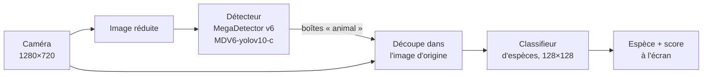

# AIDGE-MountAIn — surveillance de la faune sur Cortex-M55 + Ethos-U55

Projet du **Challenge Aidge 2026**, sujet « **AIDGE for Wildlife Monitoring** » proposé par MountAIn :
détecter les animaux sauvages et reconnaître leur espèce directement sur un microcontrôleur IA très
basse consommation, à partir de la caméra de la carte, avec un déploiement par
[Eclipse Aidge](https://eclipse.dev/aidge/).

## Sommaire

- [Le sujet](#le-sujet)
- [Notre approche](#notre-approche)
- [État d'avancement](#état-davancement)
- [Organisation du dépôt](#organisation-du-dépôt)
- [Démarrage](#démarrage)
- [Contribuer](#contribuer)
- [Liens](#liens)

## Le sujet

Objectifs fixés par MountAIn
([plaquette](https://deepgreen.ai/storage/PDF/Plaquette_ChallengeAidge.pdf), p. 8) :

1. Entraîner un modèle YOLO sur un jeu de données spécialisé et le déployer sur une cible embarquée avec
   Aidge, en réduisant la résolution des images si besoin.
2. Profiler l'exécution du modèle pour trouver les couches à optimiser et les pics d'utilisation mémoire.
3. Restructurer le modèle et optimiser les noyaux de calcul pour améliorer la performance et augmenter la
   résolution.

Le jury attribue deux prix ([règlement](https://deepgreen.ai/storage/PDF/Reglement-ChallengeAidge.pdf)) :
**meilleur démonstrateur** (2 000 €) et **meilleure contribution à Aidge** (1 000 €). Les livrables, un
rapport en PDF et une vidéo de démonstration publiés sous CC BY 4.0, sont à rendre avant le
**31 décembre 2026** ; soutenance le **14 janvier 2027**.

**Matériel.** La carte cible est l'**AppKit Alif Ensemble E7** prêtée pour le challenge :
Cortex-M55 + Ethos-U55 (256 MAC) pour la partie haute performance, Cortex-M55 + Ethos-U55 (128 MAC) pour
la partie basse consommation, 13,5 Mo de SRAM, 5,5 Mo de MRAM, caméra MT9M114 et écran LCD 480×800.

## Notre approche

Un pipeline en deux étapes, entièrement sur le M55-HP et son Ethos-U55 :



- **Détecteur** : MegaDetector v6 (`MDV6-yolov10-c`, famille YOLOv10), affiné sur nos données. Son rôle
  se limite à trouver les animaux.
- **Classifieur** : reconnaît l'espèce sur chaque découpe. Classes actuelles (`class_names.json`) :
  blaireau, chevreuil, écureuil, renard, sanglier.
- **Pourquoi deux étapes** : le détecteur voit l'image entière fortement réduite, où un animal lointain
  ne fait que quelques dizaines de pixels ; le classifieur travaille sur la découpe de l'image d'origine,
  avec beaucoup plus de détails, pour un coût de quelques millisecondes par animal. Ce choix sera validé
  en le comparant à un détecteur unique qui sort directement l'espèce.
- **Adaptation à l'Ethos-U55** : les premières mesures Vela montrent que les activations SiLU et le bloc
  d'attention PSA de YOLOv10 coûtent cher sur le NPU (respectivement environ 45 % et 30 % du temps) ; les
  remplacer par ReLU et retirer le PSA divise le temps d'inférence par environ 3 (estimation Vela sur
  YOLOv10n). Détails et chiffres dans
  [AGENTS.md](AGENTS.md#modèles).

## État d'avancement

| Étape | État | Où |
|---|---|---|
| Jeu de données à 5 espèces | script prêt | `dataset/` |
| Affinage du détecteur (640×640) | script prêt | `training/train_mdv6.py` |
| Entraînement du classifieur (128×128) | script prêt | `training/` |
| Quantification INT8 et export C++ par Aidge, pipeline complet sur PC Linux | réalisé | `export/`, `standalone_wildlife_cpp/` |
| Profilage sur Ethos-U55 (Vela) | fait pour YOLOv10n et MobileNetV2 ; MegaDetector v6 à mesurer | `u55/` |
| Firmware de la carte : caméra → NPU → écran | à faire | — |
| Déploiement Aidge sur la carte (cible `ake7`, NPU via TOSA) | à faire | — |
| Contributions à Aidge (`aidge_tosa` : Concat, Slice, pooling avec padding, plusieurs sorties par région NPU) | à étudier | — |

## Organisation du dépôt

| Dossier | Contenu |
|---|---|
| `dataset/` | Construction du jeu de données à 5 espèces (iNaturalist, découpes par MegaDetector) |
| `training/` | Récupération de MegaDetector v6, entraînement du détecteur et du classifieur |
| `export/` | Découpe et pliage ONNX, quantification INT8 et export C++ par Aidge, assemblage du pipeline autonome |
| `checks/` | Vérifications : C++ contre ONNX Runtime, pipeline Python de référence, diagnostic de la quantification |
| `standalone_wildlife_cpp/` | Pipeline C++ autonome (détecteur + classifieur), généré par `export/build_standalone_cpp.py` |
| `u55/` | Profilage Vela sur Ethos-U55, décodage de référence de YOLOv10 pour le M55 |
| `scripts/` | Environnement et compilation pour la carte Alif E7, Aidge dans Docker sur une machine Linux |
| `aidge/` | Image Docker Aidge (TOSA, export Ethos-U, Vela) |
| `samples/` | Images de test |
| `third_party/` | Dépendances C++ embarquées (`stb_image.h`) |
| `archive/` | Explorations et versions précédentes, conservées pour mémoire, non maintenues |

Les modèles (`*.onnx`, `*.pt`), les jeux de données et les exports générés par Aidge ne sont pas
versionnés ; les modèles se partagent via les GitHub Releases.

## Démarrage

Tous les scripts Python se lancent **depuis la racine du dépôt**, par exemple
`python export/quantize_pipeline_int8.py` : leurs chemins (modèles, `class_names.json`, `samples/`,
dossiers d'export) sont relatifs à la racine.

### Environnement Python (entraînement et export)

Python 3.12 est utilisé pour l'environnement de développement.

Linux / macOS :

```bash
python3.12 -m venv .venv
source .venv/bin/activate
python -m pip install -r requirements.txt
python -m pip install --no-deps aidge-quantization
```

Windows (PowerShell) :

```powershell
py -3.12 -m venv .venv
.\.venv\Scripts\Activate.ps1
python -m pip install -r requirements.txt
python -m pip install --no-deps aidge-quantization
```

L'installation de `aidge-quantization` avec `--no-deps` évite de télécharger `aidge-backend-cuda`, qui
n'est pas nécessaire aux flux CPU utilisés ici. Les dépendances `aidge-core`, `aidge-backend-cpu` et
`numpy` sont déjà installées par `requirements.txt`.

La distribution officielle de `aidge-quantization` déclare néanmoins `aidge-backend-cuda` comme
dépendance obligatoire dans ses métadonnées. Par conséquent, `pip check` peut signaler cette dépendance
absente, même si les imports et flux CPU concernés fonctionnent. Pour utiliser le backend CUDA,
installez `aidge-quantization` sans `--no-deps` et configurez le CUDA Toolkit ainsi que `CUDA_PATH`.

Aidge ne publie des wheels que pour Linux x86_64 et Windows. Sous macOS, utiliser l'image Docker de
`aidge/` (voir [AGENTS.md](AGENTS.md#aidge-sous-macos)).

### Chaîne de production des modèles

1. `dataset/build_5species_dataset.py` : construit `dataset_wildlife/`.
2. `training/train_mdv6.py` : affine MegaDetector v6 en 640 et produit `detector_v6_trained_640.onnx` ;
   `training/train_classifier_gpu.py` entraîne le classifieur en 128 et produit
   `species_classifier.onnx`.
3. `export/export_detector_v6.py` : coupe le détecteur avant le post-traitement
   (`MDV6-yolov10-c_cut_folded.onnx`) et fait l'export C++ float32 ; `export/export_classifier.py`
   produit `species_classifier_folded.onnx`.
4. `export/quantize_pipeline_int8.py` : quantification INT8 et export C++ (`export_cpp_detector_int8/`,
   `export_cpp_classifier_int8/`).
5. `export/build_standalone_cpp.py` : assemble `standalone_wildlife_cpp/`.

### Pipeline C++ sur PC Linux

Nécessite CMake 3.16+, un compilateur C++17 et les sources générées par Aidge (étapes 3 à 5 ci-dessus).
Sous Debian/Ubuntu :

```bash
sudo apt install build-essential cmake
cmake -S standalone_wildlife_cpp -B standalone_wildlife_cpp/build -DCMAKE_BUILD_TYPE=Release
cmake --build standalone_wildlife_cpp/build -j2
standalone_wildlife_cpp/build/wildlife_pipeline samples/test_wildlife_1mp.jpg
```

Le CMake attend les sources générées dans `standalone_wildlife_cpp/detector_dnn/` et
`standalone_wildlife_cpp/classifier_dnn/`, qui ne sont pas versionnées : le pipeline ne se compile donc
pas à partir du dépôt seul.

### Carte Alif Ensemble E7

```sh
source scripts/env.sh                                # outils de la carte (chemins redéfinissables dans scripts/env.local.sh)
.venv-yolo/bin/python u55/profile_yolov10_u55.py     # profilage Vela d'un détecteur sur Ethos-U55
scripts/build_img_class.sh                           # firmware de démonstration du kit ML d'Alif
```

Installation des outils (J-Link, SETOOLS, Arm GNU Toolchain, kit d'évaluation ML d'Alif), branchement de
la carte et contraintes du NPU : voir [AGENTS.md](AGENTS.md#environnement-de-la-carte).

> ⚠️ Flasher la MRAM remplace la démo d'usine, et la mise à jour du firmware de sécurité est
> irréversible. Ces opérations se décident en équipe (voir
> [AGENTS.md](AGENTS.md#opérations-à-faire-valider)).

## Contribuer

- Tout ce qui est écrit dans le dépôt est en français : documentation, commentaires, messages de commit,
  descriptions de PR.
- Travailler sur une branche et ouvrir une pull request vers `clean-main`.
- Ne pas versionner les modèles, les jeux de données ni les exports générés (voir `.gitignore`).
- `archive/` n'est plus maintenu : ne pas en dépendre.
- Les consignes détaillées (y compris pour les assistants de code) sont dans [AGENTS.md](AGENTS.md).

**Équipe** : KiraAme, MatgamFR, FogCfan, LeslieY0919.

**Licence** : à définir. Les livrables du challenge (rapport et vidéo) sont publiés sous CC BY 4.0.

## Liens

- [Règlement du challenge](https://deepgreen.ai/storage/PDF/Reglement-ChallengeAidge.pdf) et
  [plaquette des sujets](https://deepgreen.ai/storage/PDF/Plaquette_ChallengeAidge.pdf)
- [Eclipse Aidge](https://eclipse.dev/aidge/) et [`aidge_tosa`](https://gitlab.eclipse.org/eclipse/aidge/aidge_tosa)
- [MegaDetector v6 (Pytorch-Wildlife)](https://github.com/microsoft/CameraTraps)
- [Kit d'évaluation ML d'Alif](https://github.com/alifsemi/alif_ml-embedded-evaluation-kit)
